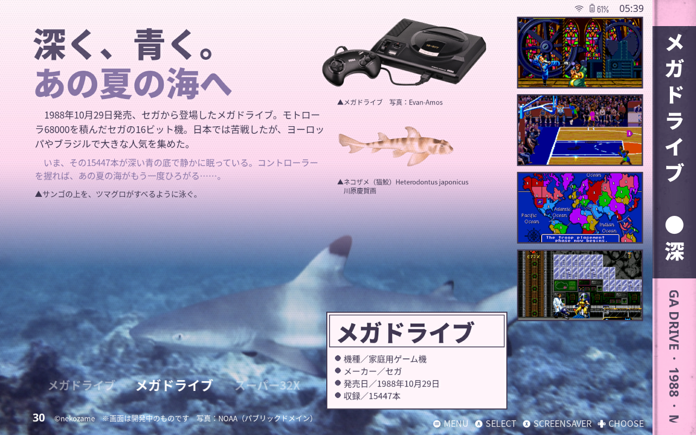

# nekozame-emu-frontend

<p align="center"></p>

nekozame's emulation frontend: a fork of [ES-DE](https://es-de.org) with nekozame's theme and new functions. `nekozame-emu esde on` installs it on [nekozame os](https://github.com/purplekairi1312/nekozame-os).

## What's different from ES-DE

- Games are named by their file names. The scraper doesn't rename them.
- Region flags, read from the file name (`(Japan)`, `(USA, Europe)`).
- nekozame and nekozame light menu colors (nekozame is the default).
- nekozame's loading screen and icon.
- ES-DE's update check is off by default.

On nekozame os, nekozame-emu also sets up:

- The nekozame theme.
- Systems ordered by maker and year, with regional versions together.
- Launching through nekozame-emu, which syncs saves.
- 3D boxes made from covers, a Ports system, and music.

How it works: [docs/guide.md](docs/guide.md).

## Install

On nekozame os:

```sh
nekozame-emu esde on
```

On other Linux systems, download `nekozame-emu-frontend_x64.AppImage` (or `nekozame-emu-frontend_x64_SteamDeck.AppImage` on a Steam Deck) from the [releases](https://github.com/purplekairi1312/nekozame-emu-frontend/releases), make it executable and run it. It uses `~/ES-DE` for its settings, like ES-DE.

## Region flags in themes

Two extra values for an `image` element's `imageType`:

| `imageType` | Shows |
|---|---|
| `flag` | The flag of the first region in the game's file name |
| `flag2` | The flag of the second, for games like `(USA, Europe)` |

```xml
<image name="flag">
    <pos>0.9 0.8</pos>
    <origin>1 1</origin>
    <maxSize>0.04 0.034</maxSize>
    <imageType>flag</imageType>
</image>
```

Regions without a flag of their own (World, Asia, Scandinavia, Latin America) show none. Everything else works as in ES-DE's [theme documentation](https://gitlab.com/es-de/emulationstation-de/-/blob/master/THEMES.md).

## Building

GitHub builds both AppImages on every push with `tools/create_AppImage_SteamDeck.sh` and `tools/create_AppImage.sh`, and publishes them when a version is tagged.

## License

GPL-3.0-or-later ([LICENSE](LICENSE)). ES-DE's code keeps its MIT license and copyright notice ([LICENSE-ES-DE](LICENSE-ES-DE)); the libraries' licenses are in [licenses](licenses), and [CREDITS.md](CREDITS.md) is ES-DE's list of the people behind it. The flags are public domain, from Wikimedia Commons ([resources/flags/CREDITS.txt](resources/flags/CREDITS.txt)).
